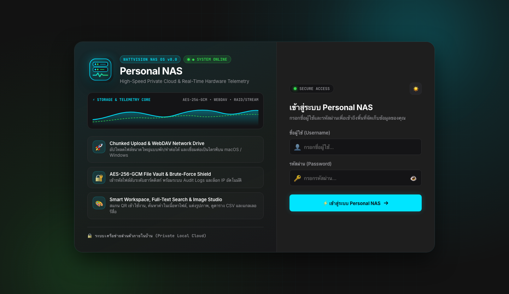
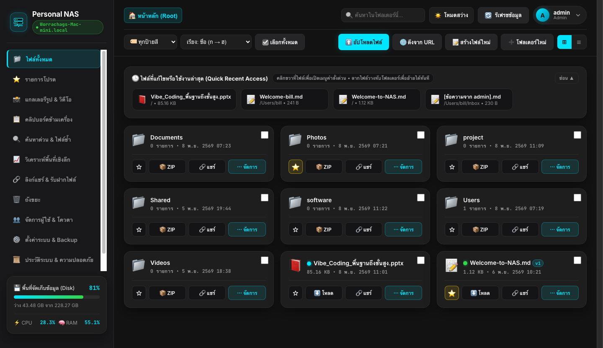
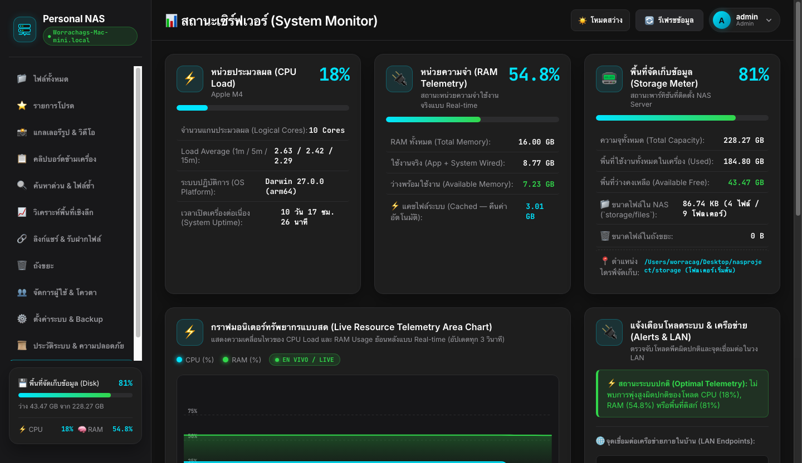
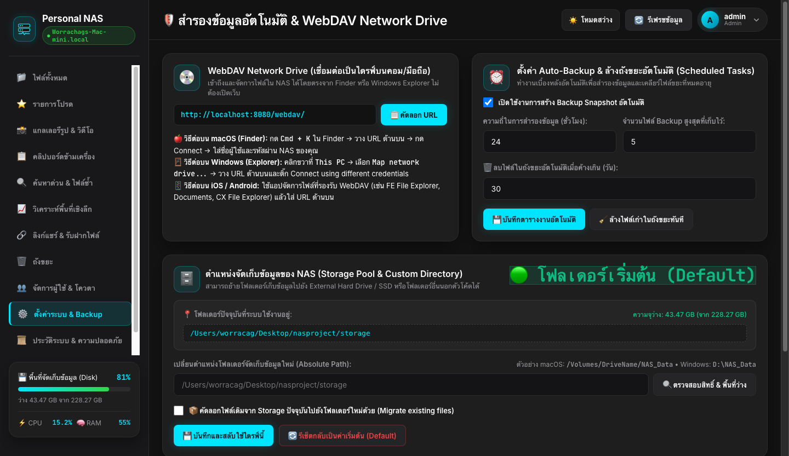
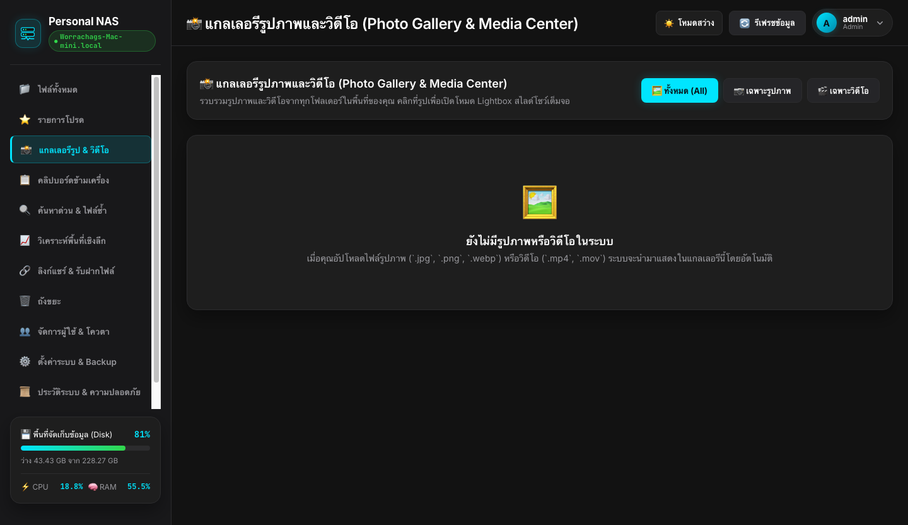
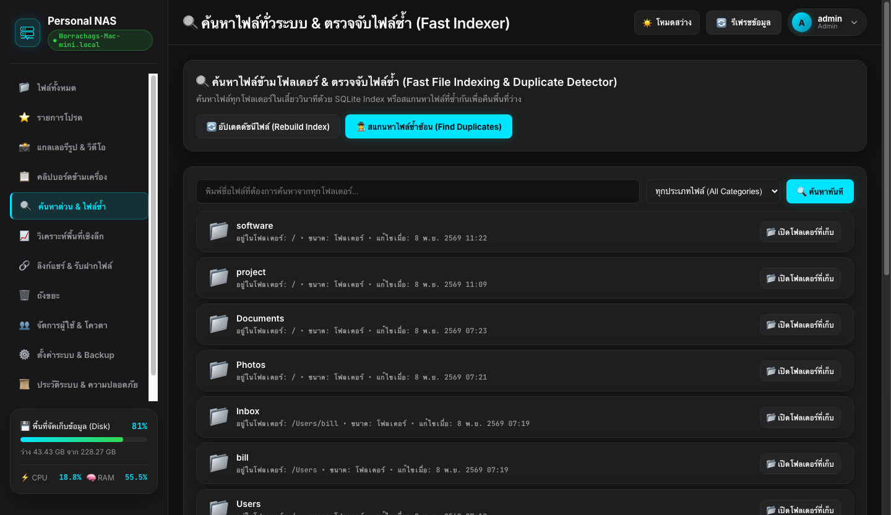

<div align="center">

# ⚡ Personal NAS Server (`WattVision NAS OS`)
### High-Speed Private Cloud, Resilient Chunked Upload & Real-Time Hardware Telemetry

[](https://nodejs.org/)
[-003B57?logo=sqlite&logoColor=white)](https://nodejs.org/api/sqlite.html)
[](https://datatracker.ietf.org/doc/html/rfc4918)
[](https://en.wikipedia.org/wiki/Galois/Counter_Mode)
[-success)](#)

ระบบ **Personal NAS (Network Attached Storage)** พัฒนาด้วย Pure Node.js Built-in 100% ไม่พึ่งพา external npm packages ออกแบบมาเพื่อเปลี่ยนคอมพิวเตอร์หรือเครื่องเซิร์ฟเวอร์ในบ้านให้กลายเป็น Private Cloud ประสิทธิภาพสูง รองรับการสลับไดรฟ์จัดเก็บข้อมูลภายนอก (External HDD/SSD Storage Pool) และเชื่อมต่อเป็น Network Drive บน macOS / Windows ได้ทันที

---

</div>

## 📸 ภาพตัวอย่างการทำงานของระบบ (Visual Showcase)

### 1. หน้าจอเข้าสู่ระบบ (WattVision Authentication & Security Portal)
ดีไซน์สไตล์ Modern Glassmorphism & Neumorphism พร้อมระบบป้องกันการสุ่มรหัสผ่าน (Brute-Force Lockout) และสลับธีมมืด/สว่างได้ในคลิกเดียว

<div align="center">
  
</div>

<br/>

### 2. พื้นที่จัดการไฟล์และเวิร์กสเปซ (File Explorer & Multi-User Workspace)
จัดการไฟล์ความเร็วสูง รองรับการลากวาง (Drag & Drop), คลิกขวาเปิด Finder Context Menu, แสดงแถบไฟล์ที่ใช้งานล่าสุด (Recent Files), สร้างไฟล์ข้อความ/Markdown ได้ในเว็บ และแชร์ลิงก์สาธารณะ

<div align="center">
  
</div>

<br/>

### 3. มอนิเตอร์ทรัพยากรฮาร์ดแวร์แบบ Real-Time (Live Telemetry & Storage Meter)
กราฟ Area Chart ตรวจวัดความเคลื่อนไหวของ CPU Load และ RAM Usage แบบ Real-time อัปเดตทุก 3 วินาที พร้อมแสดงสถานะความจุพาร์ทิชันและไดรฟ์จัดเก็บข้อมูล

<div align="center">
  
</div>

<br/>

### 4. การตั้งค่าไดรฟ์และตำแหน่งจัดเก็บข้อมูล (Storage Pool & Auto-Backup Settings)
สามารถเปลี่ยนตำแหน่งจัดเก็บข้อมูลหลักไปยัง External Hard Drive หรือ SSD ได้อิสระ พร้อมระบบทดสอบสิทธิ์การเขียนและย้ายไฟล์เดิม (Data Migration) อัตโนมัติ

<div align="center">
  
</div>

<br/>

### 5. คลังสื่อมัลติมีเดียและระบบตรวจจับไฟล์ซ้ำ (Media Center & Fast Duplicate Scanner)
<table width="100%">
  <tr>
    <td width="50%" align="center">
      <strong>📸 แกลเลอรีรูปภาพ & วิดีโอ (Photo & Video Gallery)</strong><br/><br/>
      
    </td>
    <td width="50%" align="center">
      <strong>🔍 ระบบค้นหาด่วน & ตรวจจับไฟล์ซ้ำ (SHA-256 Duplicate Finder)</strong><br/><br/>
      
    </td>
  </tr>
</table>

---

## 🌟 ฟีเจอร์เด่นสำคัญของระบบ (Key Features)

### 🚀 1. Resilient Chunked & Resumable Upload (อัปโหลดไฟล์ขนาดใหญ่แบบพัก/ทำต่อได้)
- หั่นไฟล์ออกเป็น Chunk ขนาด 1MB - 8MB ตามขนาดไฟล์แบบ Adaptive
- รองรับการกด **⏸️ พัก / ▶️ ทำต่อ** และทำงานต่อจาก Offset เดิมได้ทันทีแม้เน็ตหลุดหรือปิดแท็บ
- ระบบ **Screen Wake Lock** ป้องกันหน้าจอมือถือ/คอมพิวเตอร์เข้าสู่โหมดสลีประหว่างโอนย้ายไฟล์ใหญ่
- รองรับการกู้คืนและตัดส่วนที่เสีย (Rollback Truncation) ป้องกันปัญหา Offset Conflict ค้างถาวร

### 🗄️ 2. Dynamic Storage Pool & Custom Directory (เลือกโฟลเดอร์เก็บข้อมูลอิสระ)
- รองรับการย้ายโฟลเดอร์จัดเก็บข้อมูลหลักไปยัง **External HDD / SSD** หรือไดรฟ์ภายนอก เช่น `/Volumes/ExternalDrive/NAS_Data`
- ตั้งค่าได้สะดวกผ่านหน้า **Web UI Admin** หรือกำหนดผ่านตัวแปร `STORAGE_PATH` ใน Environment
- **Safe Fallback System:** หากไดรฟ์ภายนอกถูกถอดออก ระบบจะสลับกลับมาใช้โฟลเดอร์เริ่มต้น (`storage/`) ให้อัตโนมัติ ป้องกันเซิร์ฟเวอร์เปิดไม่ติด
- มีระบบทดสอบสิทธิ์การเขียน (Write Permission) และระบบโยกย้ายไฟล์เดิม (Data Migration) ในตัว

### 💿 3. Native WebDAV Network Drive (`/webdav/`)
- รองรับโปรโตคอลมาตรฐาน **RFC 4918 WebDAV**
- เชื่อมต่อเข้ากับ **macOS Finder** (`Cmd + K`) หรือ **Windows Explorer** (`Map Network Drive`) ได้ทันทีโดยไม่ต้องเปิดเว็บ
- รองรับแอปพลิเคชัน File Manager บน iOS / Android (เช่น FE File Explorer, Documents, CX File Explorer)

### 🔐 4. Multi-user, Home Isolation & AES-256 Vault
- แอดมินสามารถจัดการผู้ใช้ แยกโฟลเดอร์ส่วนตัว (`storage/files/Users/{username}`) และตั้ง **Storage Quota** รายบุคคล
- **AES-256-GCM Vault:** เข้ารหัสล็อกไฟล์ความลับระดับฮาร์ดดิสก์ด้วยรหัสผ่านส่วนตัว
- **Brute-Force Shield:** บันทึกประวัติความปลอดภัย (Audit Logs) และล็อก IP อัตโนมัติ 15 นาทีเมื่อกรอกรหัสผ่านผิดเกินกำหนด
- **Public Share Links (`/s/:token`) & File Drop (`/d/:token`):** สร้างลิงก์ดาวน์โหลดหรือรับฝากไฟล์จากภายนอก พร้อมตั้งรหัสผ่านและวันหมดอายุ

### 🎨 5. Smart Workspace & Productivity Tools
- **Built-in Image Studio:** แต่งรูป, หมุนภาพ, พลิกมุม, ปรับขนาด (Resize) และแปลงนามสกุลไฟล์บน NAS โดยตรง
- **Full-Text Content Search (Grep):** ค้นหาคำที่อยู่ข้างในเนื้อหาไฟล์เอกสาร/โค้ด พร้อมแสดงเลขบรรทัด
- **Cross-Device Clipboard:** ส่งข้อความ โค้ด หรือลิงก์ข้ามเครื่อง (PC ↔ มือถือ) ในวง LAN
- **Audio Jukebox:** แถบเครื่องเล่นเพลงมินิด้านล่าง เล่นเพลงต่อเนื่องได้แม้เปลี่ยนหน้า
- **Offline QR Code Generator:** สร้าง QR Code สแกนเข้าเว็บหรือดาวน์โหลดไฟล์ผ่านมือถือโดยไม่ต้องพึ่งเน็ตภายนอก

---

## 🛠️ ความต้องการของระบบและการติดตั้ง (Installation & Setup)

โปรเจกต์นี้ใช้ฟังก์ชันมาตรฐานของ Node.js (`node:http`, `node:stream`, `node:fs`, `node:crypto`, `node:sqlite`) **ไม่ต้องรัน `npm install` ใดๆ ทั้งสิ้น!**

### 1. ข้อกำหนดของระบบ
- **Node.js:** เวอร์ชัน `v22.0.0` หรือสูงกว่า (แนะนำ `v25.x` สำหรับ `node:sqlite` Built-in เต็มรูปแบบ)
- **ระบบปฏิบัติการ:** macOS, Linux หรือ Windows

### 2. การเริ่มต้นใช้งาน (Quick Start)
```bash
# โคลนโปรเจกต์
git clone https://github.com/warchag/nasproject.git
cd nasproject

# รันเซิร์ฟเวอร์
node src/server.js

# หรือรันในโหมดพัฒนา (Auto-reload เมื่อโค้ดเปลี่ยนแปลง)
node --watch src/server.js
```

### 3. การเข้าใช้งาน
เมื่อเซิร์ฟเวอร์เริ่มทำงาน จะแสดง URL สำหรับเชื่อมต่อใน Console:
- **เข้าจากเครื่องเซิร์ฟเวอร์:** `http://localhost:8080`
- **เข้าจากอุปกรณ์อื่นในวง LAN (Wi-Fi):** `http://<IP-เครื่องเซิร์ฟเวอร์>:8080`
- **เชื่อมต่อ Network Drive (WebDAV):** `http://<IP-เครื่องเซิร์ฟเวอร์>:8080/webdav/`

---

## ⚙️ โครงสร้างของโปรเจกต์ (Project Structure)

```text
nasproject/
├── src/
│   ├── server.js          # HTTP API Server, Router, Streaming & Middleware
│   ├── storage.js         # Dynamic Storage Engine, Chunked Upload & Path Safety
│   ├── auth.js            # Password Hashing (scrypt), Session Token & Verification
│   ├── db.js              # SQLite Engine (node:sqlite) & Database CRUD
│   ├── system.js          # Hardware Telemetry (macOS vm_stat, CPU, RAM & Disk statfs)
│   ├── webdav.js          # RFC 4918 WebDAV Network Drive Engine
│   ├── indexer.js         # Global File Indexing & SHA-256 Duplicate Detector
│   ├── scheduler.js       # Auto-Backup Snapshot & Trash Retention Scheduler
│   ├── thumbnails.js      # On-the-fly Image/Video Thumbnail Generator
│   ├── zip.js             # High-Performance Streaming ZIP Archive Compressor
│   ├── phase5.js          # Audit Logs, IP Lockout, Versioning & Gallery
│   ├── phase6.js          # Archive Extractor, File Drop Portal, AES-256 Vault & Tags
│   ├── phase7.js          # Music Jukebox, LAN Clipboard, Batch Rename & Checksums
│   ├── phase8.js          # Pure-JS QR Generator, Content Grep, Image Studio & Kanban
│   └── phase9.js          # Process Telemetry, Finder Context Menu & Inspector
├── public/
│   ├── index.html         # WattVision Modern Dashboard Layout & Glassmorphism UI
│   ├── styles.css         # Responsive Dark/Light Theme & CSS Architecture
│   └── app.js             # Client SPA Controller, WakeLock & Chunked Upload Logic
├── data/                  # SQLite Database (nas.db) & Audit Records (Git-ignored)
├── storage/               # โฟลเดอร์เก็บไฟล์เริ่มต้น (Default Data Directory)
│   ├── files/             # พื้นที่เก็บไฟล์จริงและ Home Directory ของผู้ใช้
│   ├── trash/             # ถังขยะพร้อมประวัติกู้คืน
│   ├── backups/           # ไฟล์สำรองข้อมูล .ZIP
│   └── .cache/            # Thumbnails และ Temporary Upload Parts
└── docs/
    └── screenshots/       # ภาพหน้าจอประกอบคู่มือระบบ
```

---

## 🔒 ความปลอดภัย (Security Features)
- **Path Traversal Protection:** ตรวจสอบและบังคับ Root Sandbox ทุกการเรียกอ่านหรือเขียนไฟล์ (`resolveSafePath`) ป้องกันการเข้าถึงไฟล์ระบบนอกขอบเขต
- **Brute-Force IP Lockout:** ตรวจจับและล็อก IP ที่พยายามสุ่มรหัสผ่านเกิน 5 ครั้งต่อเนื่อง
- **Secure Password Hashing:** แฮชรหัสผ่านด้วย `crypto.scryptSync` พร้อม Unique Salt แยกทุกบัญชี
- **HTTP/1.1 Strict Headers:** บังคับ Content-Length, No-Sniff, XSS Protection และ Frame Guard ในทุกคำขอ

---

## 📄 ใบอนุญาต (License)
โปรเจกต์นี้เปิดให้ใช้งานและพัฒนาต่อเพื่อการศึกษาและใช้งานส่วนบุคคลภายในบ้าน (MIT License)
